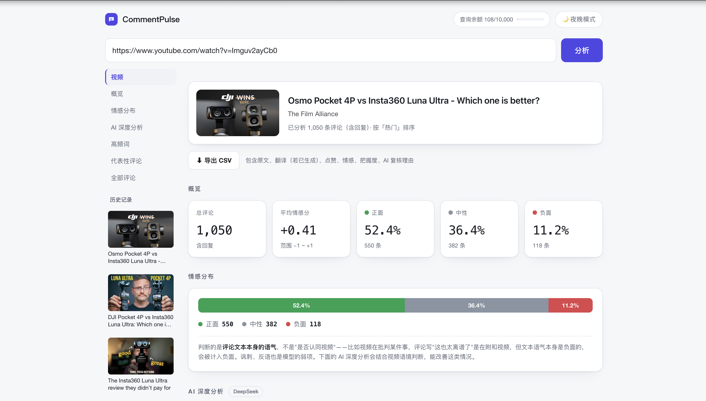
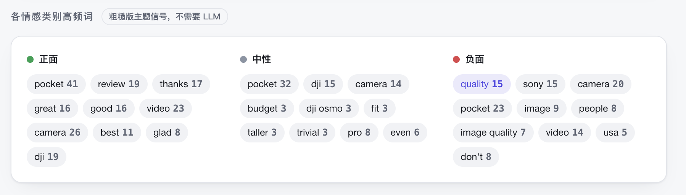
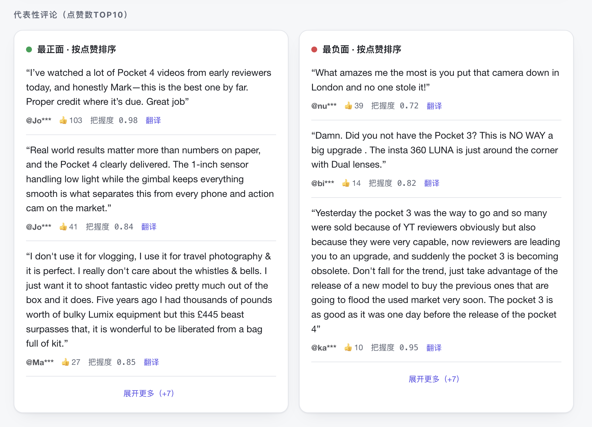
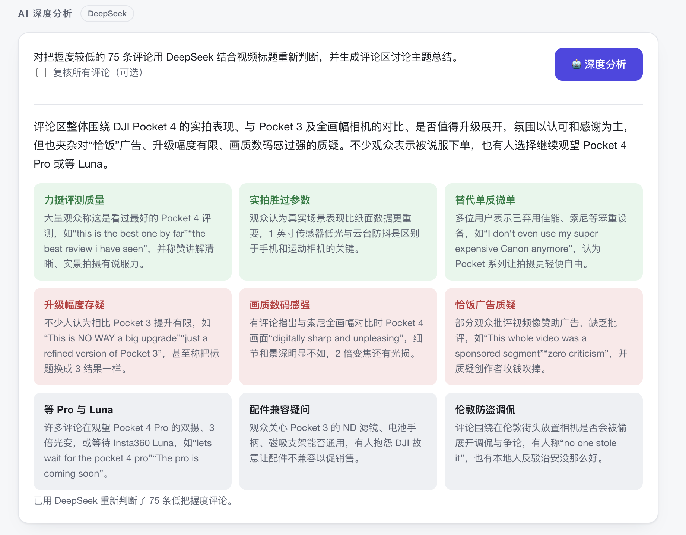
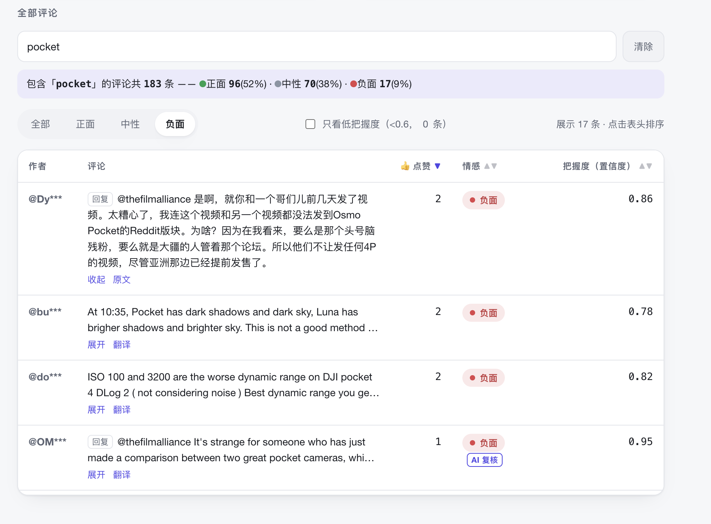

# CommentPulse — YouTube 评论区情感分析工具

需求文档见 [mini-prd.md](mini-prd.md)；部署说明见 [DEPLOY.md](DEPLOY.md)；过程记录见项目根目录的
`YouTube评论情感分析-项目日志.md`。

## 介绍

这是一个 YouTube 视频评论区分析器。输入视频链接，可以快速了解评论区的情感倾向和主要讨论内容，
帮助海外产品经理/内容运营/用户研究等低成本快速了解 YouTube 评论区针对新品或竞品的态度和主要讨论
内容，不用再一条条翻评论。

## 适用场景

- **产品经理/用户研究**：快速了解新品或者竞品在 YouTube 的反馈，发现潜在产品痛点和需求，洞察新趋势
- **海外 KOL 运营**：了解 KOL 发布的视频的反馈，完善视频内容策略
- **海外公关/舆情团队**：视频发布后快速判断口碑走向，及时发现争议点决定要不要介入回应

## 功能

<!-- 把截图存进 assets/ 文件夹，文件名对上就行，图会自动显示 -->

### 评论区情感倾向概览

- **分析所有评论情感得分**：粘贴视频链接，自动抓取全部评论，情感分析模型给每条评论打情感分
  （正面/中性/负面）
- **情绪概览**：一眼看清评论区总体情绪、三类情绪分布，以及最具代表性的评论
- **各类情绪高频词**：按情感类别拆分高频词，快速抓住大家在聊什么

- 按情感类别拆分的高频词，快速抓住每种情绪下大家具体在聊什么：

- 正负面各自最具代表性的评论（按点赞数排序），支持逐条按需翻译：

### AI 深度分析

- **部分评论主题总结**：对把握度低的评论结合视频标题重新判断，并生成评论区主题总结
- **全部评论主题总结**：可选结合全部评论和视频标题生成更全面的主题总结（更准，但调用量更大，
  需要稍等片刻）

### 全量评论表

- **按需定位**：关键词搜索 + 情感/把握度筛选 + 排序，精准定位到具体评论
- **翻译**：逐条按需中文翻译，点哪条翻哪条，不整页机翻，保留原汁原味
- **隐私风险控制**：用户名默认脱敏，保护评论者隐私
- **数据导出**：支持导出 CSV 分析结果

## 技术说明

- **数据来源**：评论数据通过 **YouTube Data API v3** 官方接口获取，不使用爬虫。API key 在 Google Cloud
  Console 官方渠道申请，合法合规，且遵守 YouTube 官方配额限制。
- **情感打分模型**：采用 [`cardiffnlp/twitter-roberta-base-sentiment-latest`](https://huggingface.co/cardiffnlp/twitter-roberta-base-sentiment-latest)
  （Twitter-RoBERTa），一个基于 RoBERTa、在约 1.24 亿条推文上微调过的情感分类模型，专门针对社交媒体
  短文本（口语化表达、缩写、emoji）优化，比通用情感分析模型更适合 YouTube 评论区这类短平快的文本。
  本地运行，零 API 成本。
- **AI 深度分析**：调用 **DeepSeek API**（`deepseek-chat` 模型），对本地模型把握度低的评论结合视频
  标题做二次判断，并分析归纳评论区的主要讨论主题——这类需要更强语言理解能力的任务本地模型做不好，
  所以设计成按需（手动点击）触发，控制调用成本。

## 目前状态

目前可在本地完整运行（Phase 1 免费本地分析 + Phase 2 AI 深度分析均已验证），接下来准备部署上线，
让别人打开链接就能用——计划和进度见 [DEPLOY.md](DEPLOY.md)。

## 批量分析与 HTML 报告

启动服务后，从页首「批量分析 / 导出报告」进入，或打开 `/static/batch.html`。

- 输入频道 `@账号`、`/channel/UC…` 或 `/user/…` 链接，读取最近 10 / 30 / 50 条公开上传视频；不支持旧式 `/c/…` 链接，请改用 @账号。列表可能包含 Shorts 和直播。
- 默认选择最近 10 条，也可自行勾选；支持每行粘贴一个视频链接，最多 10 条，可跨频道。
- 「AI 初筛疑似广告」调用 DeepSeek，仅阅读标题和简介，展示疑似状态、理由与可核对的原文依据。操作者确认后，才开始评论分析；「最近 5 条」只在当前读取范围内选择，可能不足 5 条，不保证是该频道真实的最近 5 条广告。
- 视频按顺序分析，单条失败不会删除已完成结果，可停止后继续或重试失败项。结果保存在当前页面内存，刷新前请导出。
- 可选生成各视频 AI 主题总结（每条取最多 150 条高赞评论；不进行额外情感复核）。报告包含样本范围、逐视频对比、主题、需求及高赞正负面评论证据；没有做跨视频共同主题归纳。
- HTML 报告不依赖外部样式或脚本，可独立打开，在浏览器打印菜单另存为 PDF；评论者姓名不写入报告。单视频也可通过自选一条视频导出报告。

批量分析每 IP 每小时最多 30 条视频，批量主题总结每 IP 每小时最多 15 次、全站每日受 `DEEP_DAILY_CAP` 限制（计数与单视频复核分开）。广告初筛每 IP 每小时 5 次、全站每日 40 次。上述计数重启清零，不代表严格的金额预算。

### 视频指标与代表评论

频道清单、分析结果和报告展示视频浏览量及视频点赞数（YouTube 接口读取时的快照；未返回显示未公开／未获取，真实 0 显示为 0）。详情通过弹窗展示，可关闭或按 Esc 返回。

观众高赞评论按情感分类，每类最多 10 条，排除回复、可识别的频道主本人、重复文本和模型把握度低于 0.6 的评论，再按点赞数排序。批量详情默认展示每类前 5 条，其余展开；报告展示全部入选样本，并增加中性类。该规则减少选样噪声，不保证模型分类正确，尤其多语言评论仍需核查。

批量结果中的「查看详情」复用单视频完整 Dashboard：概览、分布、高频词、观众高赞评论、全量评论筛选／排序、逐条翻译、CSV 和 AI 深度分析。详情直接载入批次已有数据，不重复抓取或情感推理；详情中新生成的翻译、AI 主题和复核结果同步回批次，用于后续报告。翻译和深度分析仍需手动触发并消耗 DeepSeek 额度。
